<div align="center">

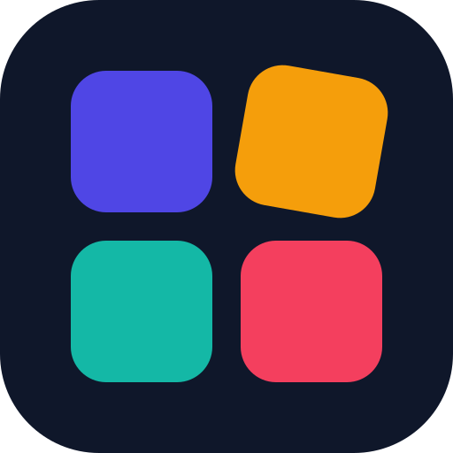

# Mosaic

**The everything app.** Tasks, calendar, habits, goals, money, food, gym, body and notes in one
self-hosted app, with a chat-first UI and an MCP server so Claude can run it with you.

[](https://github.com/ismailbentabett/mosaic/actions/workflows/ci.yml)
[](https://github.com/ismailbentabett/mosaic/actions/workflows/codeql.yml)
[](https://ismailbentabett.github.io/mosaic/)
[](LICENSE)
<br/>


[**Live demo**](https://ismailbentabett.github.io/mosaic/) ·
[Architecture](docs/ARCHITECTURE.md) ·
[Plugins](docs/PLUGINS.md) ·
[Imports](docs/IMPORTS.md) ·
[Backups](docs/BACKUPS.md) ·
[Contributing](CONTRIBUTING.md) ·
[Security](SECURITY.md)

<br/>

<picture>
  <source media="(prefers-color-scheme: dark)" srcset="docs/screenshots/desktop-today-dark.png" />
  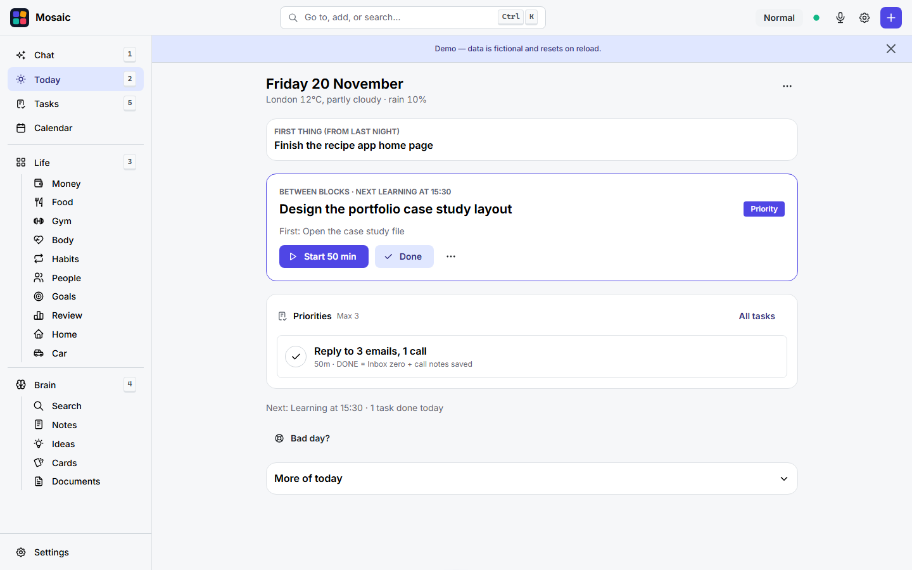
</picture>

</div>

---

## Why Mosaic

Life tools are scattered: a todo app, a budget app, a calorie counter, a gym log, a notes app, a
calendar. Each one keeps its own data and none of them talk to each other. Mosaic puts all of it
in **one SQLite file you own**, behind one consistent UI, and lets an AI assistant read and write
it through the same rules the UI uses.

> The demo runs entirely in your browser on a mock backend seeded with a fictional persona, *Sam*.
> Nothing you type leaves the page.

## Highlights

| | |
|---|---|
| 💬 **Chat first** | Home is a chat. "Spent 12 on lunch", "bench 3×8 at 60" or "remind me to call the bank Friday" become real records. |
| 🧩 **One app, 20+ areas** | Tasks, calendar, habits, goals, money, food, gym, body, people, car, notes and more, all cross-linked. |
| 🤖 **132 MCP tools** | Claude gets the same powers as the UI over MCP, validated by the same zod schemas. Parity is enforced by tests. |
| 📴 **Offline by default** | Writes go to an outbox and replay when the network is back. Client ids make replays idempotent. |
| 🔐 **Owner-only security** | scrypt + TOTP sign-in, `__Host-` cookies, `SameSite=Strict`, `Origin` checks, loopback-only API. |
| 🌗 **Light and dark, phone and desktop** | One responsive bundle, theme tokens only, enforced by a UI lint. |
| 🗃️ **Open formats** | SQLite, Markdown, CSV and ICS. No vendor lock-in, no telemetry. |

## Screenshots

<table>
  <tr>
    <td width="50%">
      <picture>
        <source media="(prefers-color-scheme: dark)" srcset="docs/screenshots/desktop-chat-dark.png" />
        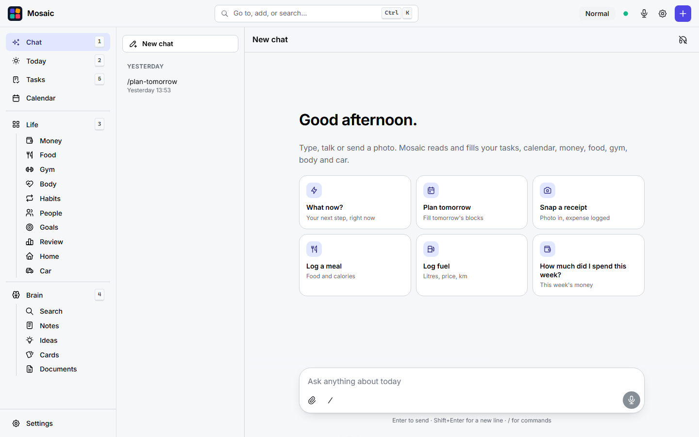
      </picture>
      <p align="center"><b>Chat</b>: plain language in, records out</p>
    </td>
    <td width="50%">
      <picture>
        <source media="(prefers-color-scheme: dark)" srcset="docs/screenshots/desktop-money-dark.png" />
        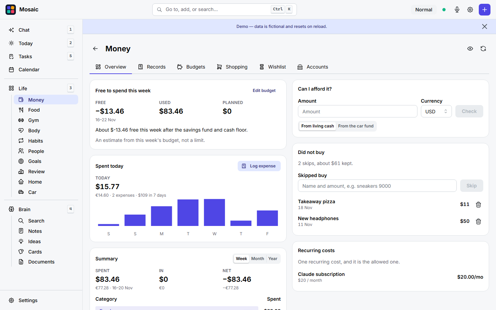
      </picture>
      <p align="center"><b>Money</b>: accounts, budgets, savings, debts</p>
    </td>
  </tr>
  <tr>
    <td>
      <picture>
        <source media="(prefers-color-scheme: dark)" srcset="docs/screenshots/desktop-tasks-dark.png" />
        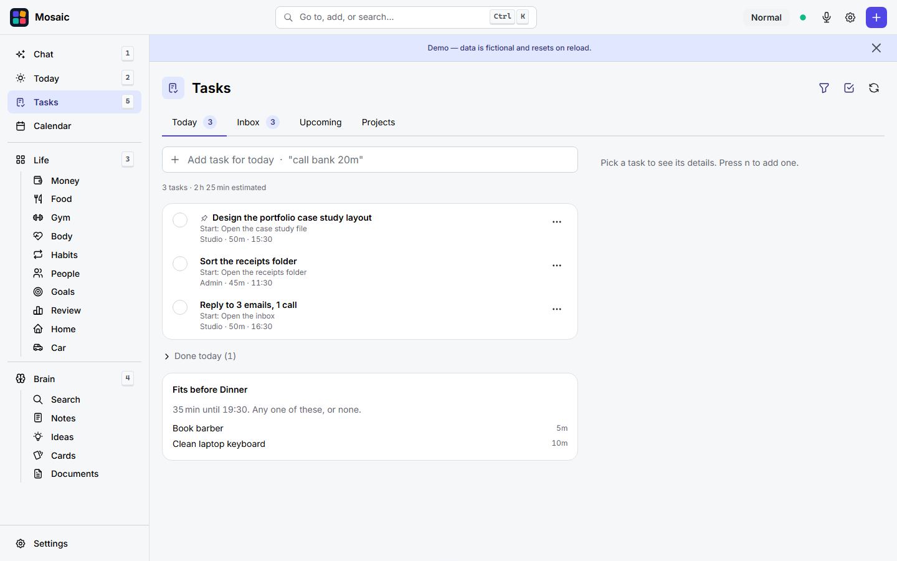
      </picture>
      <p align="center"><b>Tasks</b>: projects, inbox, recurring work</p>
    </td>
    <td>
      <picture>
        <source media="(prefers-color-scheme: dark)" srcset="docs/screenshots/desktop-calendar-dark.png" />
        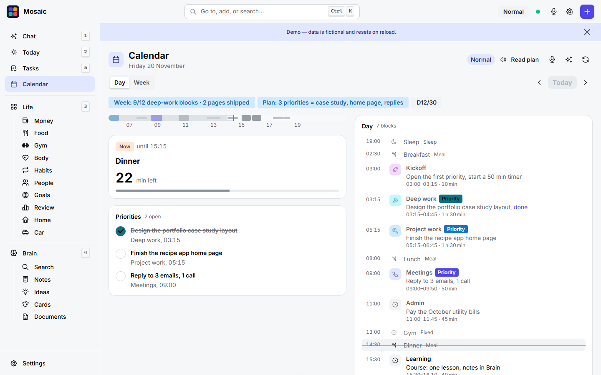
      </picture>
      <p align="center"><b>Calendar</b>: time blocks and anchors</p>
    </td>
  </tr>
  <tr>
    <td>
      <picture>
        <source media="(prefers-color-scheme: dark)" srcset="docs/screenshots/desktop-food-dark.png" />
        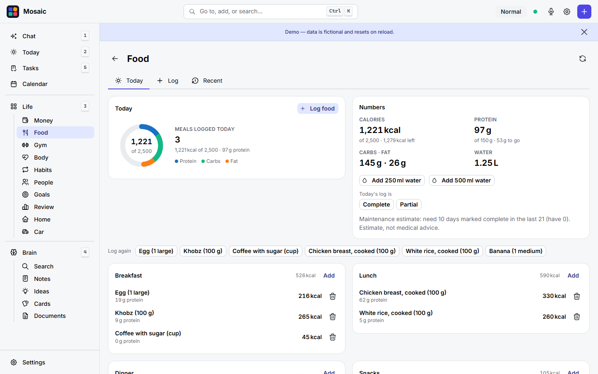
      </picture>
      <p align="center"><b>Food</b>: diary, targets, TDEE</p>
    </td>
    <td>
      <picture>
        <source media="(prefers-color-scheme: dark)" srcset="docs/screenshots/desktop-gym-dark.png" />
        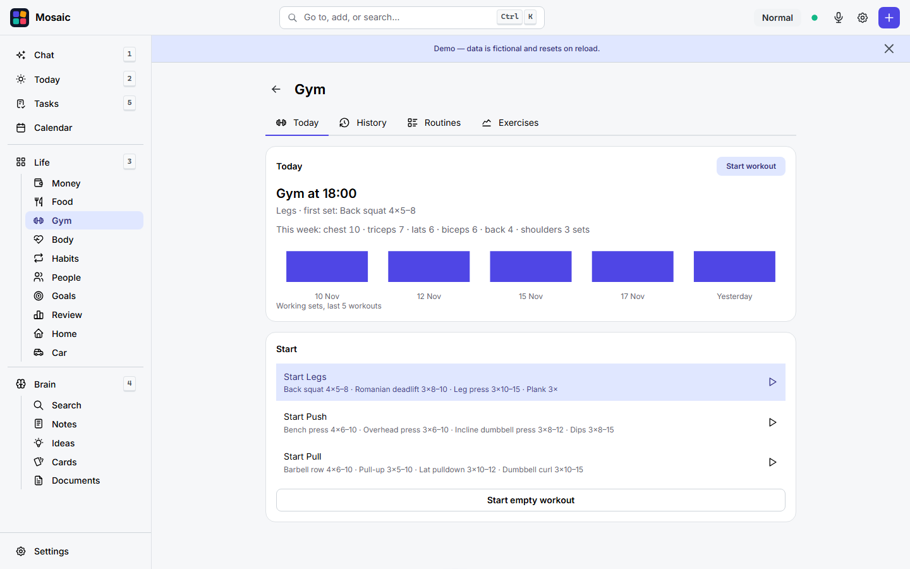
      </picture>
      <p align="center"><b>Gym</b>: routines, sets, volume</p>
    </td>
  </tr>
  <tr>
    <td>
      <picture>
        <source media="(prefers-color-scheme: dark)" srcset="docs/screenshots/desktop-goals-dark.png" />
        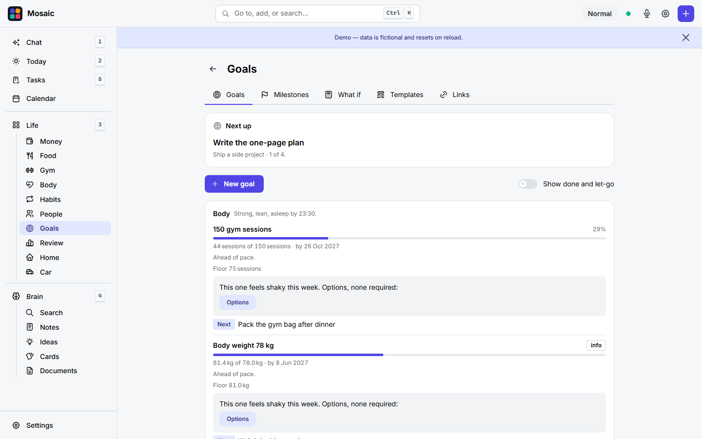
      </picture>
      <p align="center"><b>Goals</b>: milestones and next steps</p>
    </td>
    <td>
      <picture>
        <source media="(prefers-color-scheme: dark)" srcset="docs/screenshots/desktop-brain-dark.png" />
        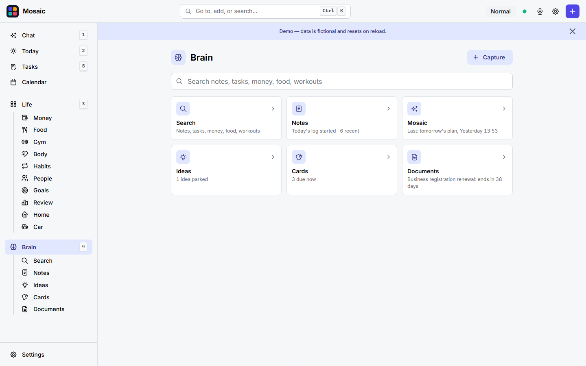
      </picture>
      <p align="center"><b>Brain</b>: search across everything</p>
    </td>
  </tr>
</table>

<details>
<summary><b>Phone</b></summary>
<br/>
<p align="center">
  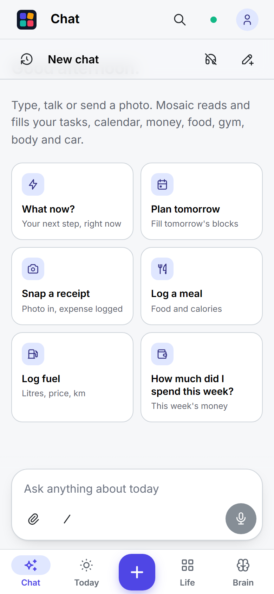
  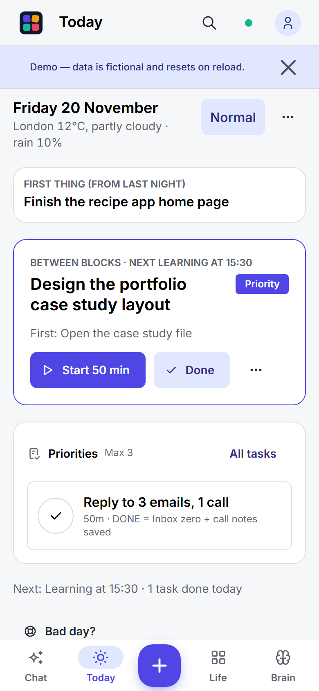
  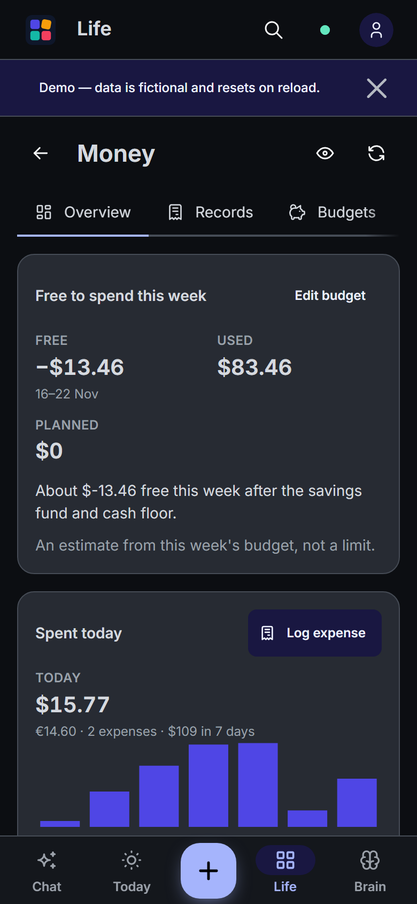
  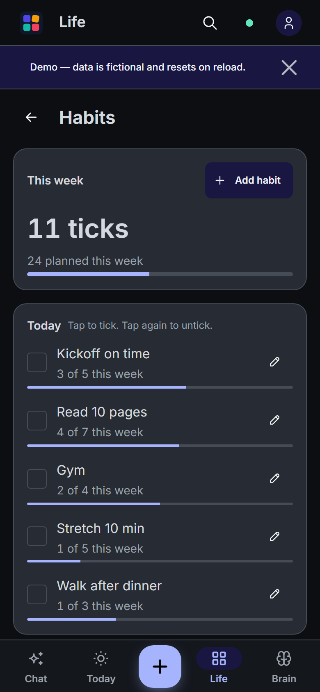
</p>
</details>

<details>
<summary><b>Life overview</b></summary>
<br/>
<picture>
  <source media="(prefers-color-scheme: dark)" srcset="docs/screenshots/desktop-life-dark.png" />
  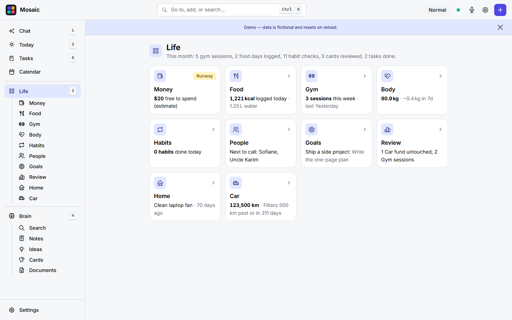
</picture>
</details>

## Architecture

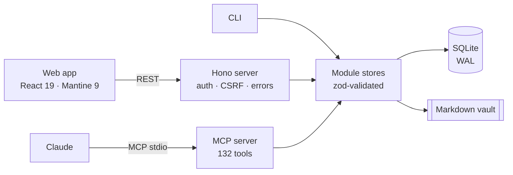

Three front doors, one set of stores, one database file. Routes and tools are thin; logic lives in
the stores and is tested against a temporary SQLite database. Full write-up, request lifecycle and
module table: **[docs/ARCHITECTURE.md](docs/ARCHITECTURE.md)**.

| | |
|---|---|
| HTTP routes | 378 (`/api`, `/api/v2`) |
| MCP tools | 132 |
| Feature screens | 20 |
| Automated tests | 278 (237 API · 41 web) |
| TypeScript | ~58k lines |

## Quickstart

Requires **Node 24** (see `.nvmrc`; the API alone runs on 22.13+).

```sh
git clone https://github.com/ismailbentabett/mosaic.git
cd mosaic
npm run setup      # installs api/ and web/
npm run dev:demo   # http://localhost:5173 on the in-browser mock backend
```

## Run the full stack

```sh
# 1. API (binds to 127.0.0.1:8787)
cd api
npm run build
MOSAIC_DEV=1 node dist/server.js       # dev only: sign-in off

# 2. Web app, in a second terminal
cd web
npm run dev                            # proxies /api to the local server
```

For a real deployment, leave `MOSAIC_DEV` unset, set the owner with the CLI
(`node dist/cli.js owner-email <email>`, `password` (read from stdin, stored as a scrypt hash),
then `2fa-setup` and `2fa-confirm`), keep data in `MOSAIC_DATA`, secrets in the environment or a `chmod 600`
file, and put a TLS reverse proxy (Caddy or nginx) in front. See [SECURITY.md](SECURITY.md).

### Connect Claude over MCP

```json
{
  "mcpServers": {
    "mosaic": { "command": "node", "args": ["/path/to/mosaic/api/dist/mcp-stdio.js"] }
  }
}
```

## Scripts

Run from the repository root.

| Script | Does |
|---|---|
| `npm run setup` | `npm ci` in both packages |
| `npm run dev:demo` | Web app on the mock backend, no API needed |
| `npm run dev:web` | Web app against a local API |
| `npm run typecheck` | `tsc` in both packages |
| `npm run lint` | UI lint: theme tokens only |
| `npm test` | API (`node:test`) and web (`vitest`) suites |
| `npm run build` | API bundles, web app and demo build |
| `npm run check` | Everything above, the same as CI |
| `npm run screenshots` | Re-renders `docs/screenshots/` with Playwright |

## Quality

- **CI** on every push and pull request: typecheck, UI lint, tests and builds; API on Node 22 and 24.
- **CodeQL** security analysis on every push and weekly.
- **Dependabot** for npm and GitHub Actions.
- **Parity tests** make sure every HTTP route has an MCP tool and a mock handler.
- **Continuous deployment** of the demo to GitHub Pages.

## Project structure

```text
api/   Hono + node:sqlite + MCP server + CLI       → api/DESIGN.md
web/   React 19 + Mantine 9 + Vite 7, mock backend
docs/  architecture guide and screenshots
```

## Roadmap

- [x] One SQLite store for every life area
- [x] MCP server with UI parity
- [x] Offline outbox with idempotent replay
- [x] Light/dark, phone/desktop, live demo
- [x] Encrypted backups to any S3-compatible store ([docs](docs/BACKUPS.md))
- [x] Plugin API for community modules ([docs](docs/PLUGINS.md), [example](examples/plugins/reading-log))
- [x] Import from common apps: Todoist, YNAB, MyFitnessPal CSV ([docs](docs/IMPORTS.md))
- [ ] Two-way calendar sync (CalDAV)
- [ ] Shared spaces for households

## License

[MIT](LICENSE) © 2026 Ismail Bentabett
