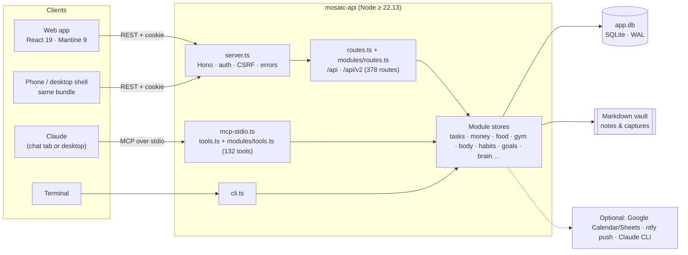
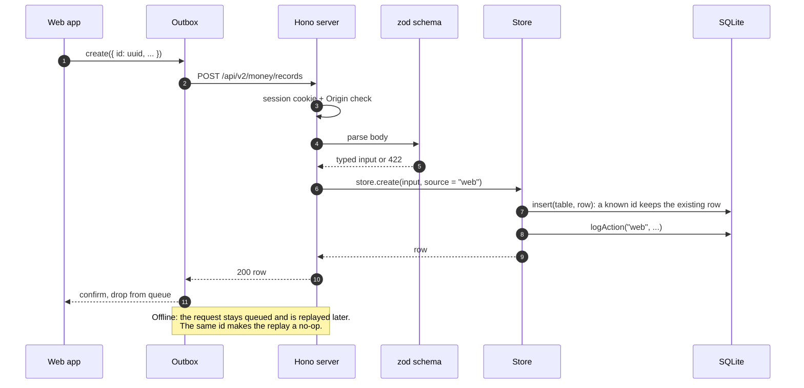

# Architecture

Mosaic is one person's whole life in **one SQLite file**, reachable through three front doors that
share the same stores: a React web app, an MCP server for Claude, and a CLI.



## Design principles

| Principle | What it means in the code |
|---|---|
| **Chat parity** | Every feature exists as an HTTP route *and* an MCP tool *and* a mock handler. `web/src/parity.test.ts` and `web/src/mockCoverage.test.ts` fail the build if one side is missing. |
| **Thin edges, fat stores** | Routes and tools only parse input with zod and delegate. Business logic lives in `api/src/modules/<module>/store.ts` and is tested against a throwaway SQLite database. |
| **Errors are values** | Stores throw `AppError(code, message)`. One middleware maps it to `{ error, message }` with 400 / 401 / 404 / 409 / 422 / 502 / 503. No stack traces leave the process. |
| **Offline first** | The web app writes through an outbox. Every create carries a client-generated `id`, so replays are idempotent. |
| **Soft deletes** | Rows get `deleted_at`, never `DELETE`. "Recently removed" and undo come for free. |
| **Provenance** | Every write calls `logAction(source, …)` with `web`, `mcp`, `cli` or `cron`, so the activity log shows who changed what. |
| **One clock** | All dates go through `api/src/time.ts`. A *life day* rolls at 04:00 local time, so a 01:00 snack belongs to the evening before. |

## Repository layout

```text
mosaic/
├─ api/                      mosaic-api: Hono + node:sqlite + MCP
│  ├─ src/
│  │  ├─ server.ts           HTTP entry: middleware, auth, static UI, error mapping
│  │  ├─ routes.ts           core routes (/api): calendar, notes, timer, push, ops
│  │  ├─ tools.ts            core MCP tools
│  │  ├─ mcp-stdio.ts        MCP server over stdio
│  │  ├─ cli.ts              command-line entry (import, backup, users, ...)
│  │  ├─ db.ts · migrate.ts  SQLite connection (WAL) and ordered migrations
│  │  ├─ auth.ts             scrypt passwords, TOTP, recovery codes, sessions
│  │  ├─ errors.ts           AppError and the HTTP mapping
│  │  ├─ time.ts             timezone and life-day helpers
│  │  └─ modules/            one folder per domain (see below)
│  │     ├─ <module>/store.ts domain logic + SQL
│  │     ├─ routes.ts        every module's HTTP routes under /api/v2
│  │     └─ tools.ts         every module's MCP tools
│  └─ test/                  node:test suites, one temp DB per test
├─ web/                      mosaic-web: React 19 + Mantine 9 + Vite 7
│  ├─ src/
│  │  ├─ app/                shell, routes, theme, brand, spotlight, shortcuts
│  │  ├─ features/           one folder per screen (chat, today, money, gym, ...)
│  │  ├─ mock/               in-browser backend used by the demo and tests
│  │  ├─ outbox.ts · queue.ts offline write queue with idempotent replay
│  │  └─ api.ts · v2.ts      typed fetch clients
│  └─ scripts/               ui-lint, screenshots
├─ docs/                     this file, screenshots
└─ .github/                  CI, CodeQL, Pages deploy, templates
```

## Domain modules

Each module folder in `api/src/modules/` holds a `store.ts` (logic + SQL) and, where needed, a
`schema.ts` (zod). HTTP routes are mounted in `modules/routes.ts` and MCP tools registered in
`modules/tools.ts`, so the whole surface is reviewable in two files. The web app has a matching
feature folder and a mock handler.

| Module | Holds | Example MCP tools |
|---|---|---|
| `tasks` | Projects, tasks, inbox, recurring tasks, done log | `tasks_add`, `tasks_list`, `tasks_done` |
| `money` | Accounts, every expense and income, budgets, savings, debts, transfers | `money_log`, `money_summary`, `money_budget` |
| `food` | Food diary, food search, daily targets, TDEE | `food_log`, `food_day`, `food_tdee` |
| `gym` | Routines, workouts, sets, volume, notes for next session | `gym_log_workout`, `gym_last`, `gym_volume` |
| `body` | Weight, sleep and other body metrics | `body_log`, `body_summary` |
| `life` · `habitat` | Habits and check-ins, goals, milestones, what-if | `habits_checkin`, `goals_tree` |
| `brain` | Search across notes, docs and records | `brain_search` |
| `people` | Contacts, last touch, occasions, promises | `people_due`, `promises_add` |
| `car` | Vehicles, fuel, service, papers, listings | `car_overview`, `car_fuel_log` |
| `grades` · `screentime` · `extras` | Smaller trackers | `grades_week`, `screentime_summary` |
| `profile` | Profile facts and the "asks" queue the app uses for personal questions | `profile_get`, `asks_next` |

## Request lifecycle



## Web app

- **Routing:** `HashRouter`, so the static build works from any path (GitHub Pages included).
- **Data:** typed clients in `api.ts` / `v2.ts`. Writes go through `outbox.ts`, which survives reloads and replays in order once the network is back.
- **Chat first:** the chat screen is home. Quick-add parses free text ("spent 12 on lunch") into the same actions the screens use.
- **Theme:** Mantine theme tokens only. `npm run lint:ui` rejects raw hex colours, font sizes and numeric gaps in screen code.
- **Demo mode:** `vite build --mode demo` swaps the network layer for `web/src/mock/`, an in-memory backend seeded with the fictional persona *Sam*. That is what the live demo runs.

## Testing strategy

| Layer | Tool | What it proves |
|---|---|---|
| Stores | `node:test` + temp SQLite | Business rules, idempotent creates, soft deletes, life-day maths |
| HTTP | `node:test` against the Hono app | Auth, validation, error mapping |
| MCP | `node:test` | Every tool validates and reaches the right store |
| Web | `vitest` | Outbox replay, formatting, parity between API, MCP and mock |
| Visual | Playwright (`npm run screenshots`) | Every main screen renders in light and dark, desktop and phone |

## Security

See [SECURITY.md](../SECURITY.md) for the full model. In short: owner-only sign-in (scrypt + TOTP),
`__Host-` cookies with `SameSite=Strict`, an `Origin` check on writes, the API bound to
`127.0.0.1` behind a TLS proxy, zod on every input, and secrets only in the environment.

## Optional integrations

All are off unless configured, and the app works fully without them.

| Integration | Used for |
|---|---|
| Google Calendar / Sheets | Mirror time blocks and totals |
| ntfy | Push notifications with HMAC-signed one-tap actions |
| Claude CLI | The in-app chat tab (one conversation at a time; a second request gets 409) |
